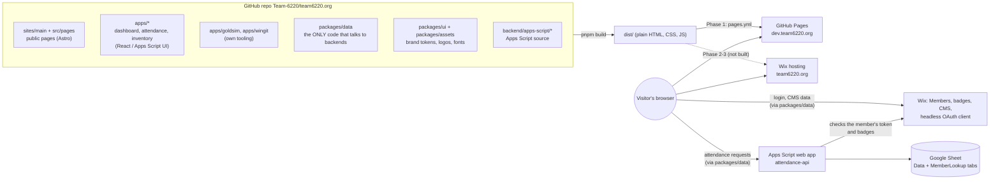
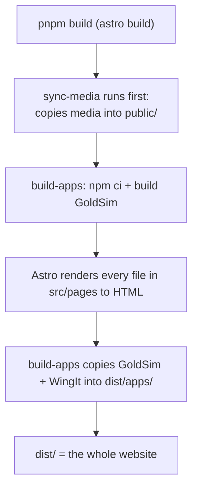

# How the whole thing fits together

Read this first. It explains the pieces and how a click in a browser ends up as data in a Google Sheet or a Wix
database. New words are explained in [TOOLS.md](TOOLS.md).

## The idea in one paragraph

`team6220.org` is one website built from **one GitHub repo**. The public pages (home, about, robots, sponsors, ...) and
the team **apps** (dashboard, Attendance, Inventory, GoldSim, WingIt) are all built together by **Astro** into a pile of
plain files. **Wix** is only the backend: it stores our data in its CMS and runs the member login. **Google Apps
Script** is a second small backend that writes the attendance Google Sheet. Today (Phase 1) the finished files are
published for free by GitHub Pages at `dev.team6220.org`. Later (Phase 2/3) the same repo is hosted by Wix at
`team6220.org`. Full plan: [MIGRATION-PLAN.md](MIGRATION-PLAN.md).

## The big picture



Three things to take from the picture:

1. **Browsers do the work in Phase 1.** There is no server of ours. The page's JavaScript talks straight to Wix and to
   Apps Script. That is why nothing secret can be in the code, and why "hiding a button" is not security
   ([details](#where-security-really-lives)).
2. **`packages/data` is the single doorway.** Apps never talk to Wix themselves. In Phase 2 only that package changes
   (to call our own `/api/*` endpoints) and every app keeps working.
3. **Wix owns identity and most data; Apps Script owns attendance rows.** Attendance keeps writing to the same Sheet
   in the same row format so the old scanner and the new screen can run side by side.

## The folder map

```text
astro.config.mjs        Astro settings: integrations, the site URL
package.json            Root scripts (dev, build, check, preview) and which app packages the site imports
pnpm-workspace.yaml     Which folders are packages (and which are not)
src/
  pages/                Every web address. Thin files: pick a layout, drop in sections or an app
    index.astro, robots.astro, sponsors.astro, merch.astro, summer-camp.astro
    about/, resources/  Pages with sub-addresses
    apps/               /apps (dashboard), /apps/attendance, /apps/inventory, /apps/login/callback, /apps/logout
  layouts/              BaseLayout (head tags, favicon), AppLayout (plain shell for apps)
sites/main/             The public website: content, styles, scripts, media. Nothing else imports from here
  config/site.ts        Webmaster switches (summer camp on/off, store link, Log In link)
  data/                 Lists the pages are built from (nav.ts, robots.ts, resources.ts, apps.ts, old-anchors.ts)
  sections/             The actual page content, one folder per page
  components/           Header, Footer, hero banner, logo sprite, loader and intro markup
  styles/site.css       All public-site styling and its color/font variables
  media/                Images and videos for the public site -> served at /assets/main/...
apps/
  dashboard/            /apps: sign-in + a card per app. Also THE list of apps (src/apps.ts)
  attendance/           /apps/attendance (React)
  inventory/            /apps/inventory (original Apps Script UI on a shim; see its README)
  goldsim/, wingit/     Imported apps with their own tooling; built into dist/apps/ by integrations/build-apps.mjs
packages/
  data/                 Wix + Apps Script access, login, badges, inventory service and tests
  ui/                   Shared design tokens (tokens.css) for the apps
  assets/               Shared logos, fonts, favicon (published at /assets/shared/ and the site root)
backend/apps-script/    Source of the Google Apps Script projects (attendance, attendance-api, inventory)
integrations/           Two Astro build helpers: sync-media.mjs and build-apps.mjs
public/                 CNAME (the dev.team6220.org setting) and generated media. Don't edit generated files
docs/                   You are here
.github/                CI, Pages deploy, CODEOWNERS, Dependabot, PR template
```

## How a page gets built



- **`integrations/sync-media.mjs`** runs whenever Astro starts (including `pnpm dev`). It copies
  `packages/assets/<folder>` to `/assets/shared/<folder>/`, `packages/assets/favicon/*` to the site root,
  `sites/<name>/media` to `/assets/<name>/`, `sites/<name>/scripts` to `/assets/<name>/js/` and `apps/<name>/media`
  to `/assets/<name>/`, all inside `public/`. `public/assets/` and the generated favicons are **git-ignored copies**;
  edit the sources, never the copies.
- **`integrations/build-apps.mjs`** runs on `astro build` only. It builds GoldSim (`npm run build` with base path
  `/apps/goldsim/`, installing its dependencies first if needed) and copies WingIt's files, so `dist/apps/goldsim/` and
  `dist/apps/wingit/` exist. `pnpm dev` does **not** serve them.
- **Public pages** are `.astro` files that render fixed HTML at build time. **App pages** under `/apps` ship a React
  component (or, for Inventory, the original HTML UI) that runs in the browser (`client:only="react"`), because what it
  shows depends on who is signed in.

## Login: how the browser proves who you are

Members sign in with **Wix Members + Google** (no `team6220.org` account needed). In Phase 1 the browser runs Wix's
"login page" OAuth flow itself. All of it lives in `packages/data/src/auth.ts` and `wix.ts`.

```mermaid
sequenceDiagram
  participant M as Member's browser
  participant S as Site (/apps)
  participant W as Wix login page
  M->>S: open /apps, press Sign in
  S->>W: auth.login(): go to Wix login page (our client ID)
  W->>W: member picks "Log in with Google"
  W->>M: redirect to /apps/login/callback#code=...
  M->>S: callback page: auth.handleLoginCallback()
  S->>W: exchange the code for member tokens
  W-->>S: tokens (kept in this browser's localStorage)
  S->>M: back to where you started; dashboard shows your apps
```

- **Approval.** A brand-new signup is `PENDING` until a Web Admin approves them in the Wix dashboard and gives them
  the `Team Member` badge. Until then the dashboard says "Waiting for approval". `auth.getAccess()` returns
  `"approved"`, `"pending"` or `"signed-out"`.
- **Badges** (`Team Member`, `Attendance Admin`, `Web Admin`) are labels in Wix. Their exact spelling is in `BADGES`
  in `packages/data/src/config.ts`; always compare with that constant, never a typed string.
- **Redirect URIs.** Wix only sends people back to addresses listed on the headless client. If login says the redirect
  URI is not allowed, see [TROUBLESHOOTING.md](TROUBLESHOOTING.md#redirect-uri-rejected).

## Where the data lives

| App | Data lives in | How the browser reaches it |
| --- | --- | --- |
| Public pages | In the repo (`sites/main/data`, `sections/`, `config/`) | Baked into the HTML at build time |
| Dashboard | Wix Members (who you are, your badges) | `auth.*` from `@team6220/data` |
| Attendance | A Google Sheet (tabs `Data`, `MemberLookup`) | `attendance.*` from `@team6220/data` to the `attendance-api` Apps Script, which checks the member's Wix token and badges |
| Inventory | Wix CMS collections named `inventory_*` | The original UI calls a `google.script.run` shim, which calls `inventory` in `@team6220/data`, which calls Wix Data as the signed-in member. In `pnpm dev` and tests it uses in-memory demo data instead |
| GoldSim, WingIt | The visitor's browser only (GoldSim's cloud saves are planned for Wix, #66) | Static files |
| Scouting, Pit display, Production Tracker | Planned (Wix CMS) | Not built |

## Where security really lives

The repo and every byte sent to a browser are public, so:

- **Phase 1 (now).** The only real locks are (1) **Wix CMS collection permissions** (set to *Site members*, never
  *Anyone*) and (2) the **attendance Apps Script**, which verifies each member's token and badges with Wix on every
  request. A badge check in a React component only hides a button; anyone can read the page's JavaScript.
  So do not store anything in Phase 1 apps that you would not want every approved member to be able to reach.
- **Phase 2 (not built).** The site runs on Wix hosting with server endpoints at `/api/<name>`. Those check badges on
  the server, so "only Attendance Admins can open the kiosk" becomes a real rule. Secrets (Wix API key, Nexus and The
  Blue Alliance keys) live only in those endpoints.

## What Phase 2 changes (so you don't build against the grain)

| Today (Phase 1) | Phase 2 and 3 |
| --- | --- |
| GitHub Pages serves static files at `dev.team6220.org` | Wix hosting serves the site (and server code) at `team6220.org` |
| `pages.yml` deploys on every merge | `pages.yml` is deleted; Wix preview builds per PR and a manual release |
| Browser calls Wix/Apps Script directly | Browser calls `/api/*`; only `packages/data` function bodies change |
| `auth.ts` runs the OAuth flow in the browser | The Wix Astro integration owns `/api/auth/*`; `/apps/login/callback`, `wix.ts` and the `localStorage` tokens go away |
| Content changes need a PR with code edits | The Site Manager app ([SITE-MANAGER.md](SITE-MANAGER.md), #109) opens PRs from forms |

None of this is built yet. [packages/data/README.md](../packages/data/README.md) lists exactly which functions change.

## Why it is organized this way

- **One list per fact.** The apps list is `apps/dashboard/src/apps.ts`; the dashboard, the Resources page and the
  Resources menu all read it. Menu: `sites/main/data/nav.ts`. Robots: `sites/main/data/robots.ts`.
- **Each app owns its folder** so a CODEOWNERS line per app can route reviews.
- **`packages/data` is the only Wix/Apps Script code**, so swapping a backend never touches UIs.
- **Media sits next to what uses it** (`sites/main/media`, `apps/<name>/media`) or in `packages/assets` when shared.
