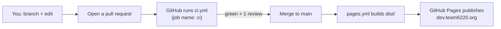

# Deploy and CI

How a change travels from your keyboard to the website, what the automatic checks do, and where secrets belong.
Plain-language explanations of GitHub Actions and Pages are in [TOOLS.md](TOOLS.md).

## The current flow (Phase 1: GitHub Pages)



1. Create a branch, make your change, push it.
2. Open a **pull request** into `main`. The template (`.github/pull_request_template.md`) reminds you what to check.
3. **`ci`** runs automatically. It must pass before the merge button works.
4. A reviewer approves (GitHub routes PRs to `@Team-6220/webmasters` through `.github/CODEOWNERS`).
5. Merge. `pages.yml` builds the site and publishes it. It takes a minute or two; watch it in the repo's **Actions** tab.

You never upload files by hand. The live site is always "whatever `main` built last".

> The real **`team6220.org` is still the old Wix Studio site** and is untouched until Phase 3. What you publish today is
> only the prototype at `dev.team6220.org`.

## The three workflows (`.github/workflows/`)

### `ci.yml` (name: CI, required job: `ci`)

Runs on every pull request. Steps, in order:

1. Check out the code, install **pnpm**, install **Node** from `.nvmrc` (22), with a pnpm cache.
2. `pnpm install --frozen-lockfile`: fails if `package.json` and `pnpm-lock.yaml` disagree.
3. `npm ci` inside `apps/goldsim` (GoldSim has its own lockfile; the npm cache is keyed on it).
4. `pnpm check`: type-check (Astro's checker). Must report 0 errors.
5. `pnpm -r --if-present test`: run every package that has a `test` script.
6. `pnpm build`: build the whole site, including GoldSim and WingIt.

Reproduce it on your computer before pushing: `pnpm install && pnpm check && pnpm -r --if-present test && pnpm build`
(add `npm ci` in `apps/goldsim` the first time; `pnpm build` does that itself if `apps/goldsim/node_modules` is
missing). A concurrency rule cancels an older run when you push again.

### `pages.yml` (Deploy to GitHub Pages)

Runs on every push to `main` (and by hand: Actions tab → *Deploy to GitHub Pages* → **Run workflow**). It does the same
install and `pnpm build`, uploads `dist/` and deploys it with GitHub's official Pages actions. It is a Phase 1 file: **it
is deleted in Phase 2** when hosting moves to Wix, because GitHub Pages cannot run server code.

The pieces that make `dev.team6220.org` work (all done in Phase 0, see [PHASE-0.md](PHASE-0.md)):

- Repo **Settings → Pages → Source: GitHub Actions**.
- `public/CNAME` containing `dev.team6220.org`.
- A DNS **CNAME** record in Wix Domains: host `dev`, value `team-6220.github.io` (plus the TXT record that verifies the
  domain for the organization). See [WIX-SETUP.md](WIX-SETUP.md#domain-and-dns).
- **Enforce HTTPS** ticked in the Pages settings.
- `astro.config.mjs` has `site: "https://dev.team6220.org"` and `output: "static"`.

### `goldsim.yml` (GoldSim checks)

GoldSim's own lint, typecheck and tests (`npm run check` in `apps/goldsim`, about 8 minutes). It runs only when files under
`apps/goldsim/` change, and it is **not required** to merge. The workflows inside `apps/goldsim/.github/` came with the
import and do **not** run (GitHub only reads the root `.github/`).

### Dependabot

`.github/dependabot.yml` opens pull requests weekly for npm packages (Astro packages grouped, `@wix/*` grouped; at most
5 open) and for GitHub Actions. Review them like any PR; `ci` tells you whether the update breaks the build. Be careful
with `astro`, `@astrojs/react`, `react` and `typescript` bumps: the combinations are pinned for reasons listed in
[TROUBLESHOOTING.md](TROUBLESHOOTING.md#version-pins).

## Branch protection and who can merge

Set in GitHub (not in code) during Phase 0: a ruleset on `main` that requires a pull request, **1 approval**, review from
Code Owners, the **`ci`** status check, and blocks force-pushes and deletions. The org owners and the `webmasters` team are
listed in [PHASE-0.md](PHASE-0.md). I could not read the live GitHub settings from this repo, so if merging behaves
differently than described, check **Settings → Rules → Rulesets**.

**Merging pull requests that add or move whole imported folders** (GoldSim, WingIt): use **Create a merge commit**, not
squash or rebase, or their history is lost.

## Preview your change before you push

```sh
pnpm dev                     # live-reloading dev server at http://localhost:4321 (GoldSim and WingIt are not served here)
pnpm build && pnpm preview   # exactly what gets published, served from dist/
```

## Secrets

**This repo is public. Assume anyone can read every file, every commit, and every byte shipped to a browser.**

| Safe to commit | Never commit or ship to a browser |
| --- | --- |
| The Wix headless **client ID** (`packages/data/src/config.ts`) | Wix **API keys** and the client secret in `.env.local` |
| Apps Script web-app `/exec` URLs | The Nexus and The Blue Alliance keys |
| `PUBLIC_*` build settings (like `PUBLIC_ATTENDANCE_API_URL`, `PUBLIC_MEDIA_BASE`) | Passwords, passcodes, recovery codes |
| Made-up test data | Real inventory exports (`.gitignore` blocks CSVs under `apps/inventory/` except test fixtures) and student data |

Where each kind of secret goes:

| Secret | Home |
| --- | --- |
| Your own API key for a one-off script | Your shell for that run only (`export WIX_API_KEY=...`), then `unset` and revoke it ([WIX-SETUP.md](WIX-SETUP.md#api-keys)) |
| Local settings | `.env` / `.env.local` files. They are git-ignored (`.env`, `.env.*`, except `.env.example`) |
| CI secrets (Phase 2) | GitHub: repo Settings → Secrets and variables → Actions, or an *environment* (the plan names one `wix`) |
| Server-side keys (Phase 2) | Wix secret environment variables, used only in `/api` endpoints |
| Apps Script settings | Script Properties of that project |

`.env.example` shows which variables exist (`PUBLIC_MEDIA_BASE`, `PUBLIC_INVENTORY_BACKEND`). Anything beginning with
`PUBLIC_` is baked into the page and visible to everyone: that is intentional and only for non-secret values.

If you commit a secret by accident: **revoke/rotate it first** (a key in git history is burned), then tell a webmaster. Turn
on (Phase 0 item 5) secret scanning and push protection in GitHub **Settings → Code security**.

**Current state of CI secrets:** the current workflows use none (only GitHub's built-in token and Pages permissions). I could
not list the repository's actual secrets or environments from here.

## Build variables

A `PUBLIC_*` variable is read at build time. To set one for the published site, add `env:` to the `pnpm build` step in
`pages.yml` (none are set today). Locally put it in `.env` or prefix the command (`PUBLIC_INVENTORY_BACKEND=mock pnpm build`).

| Variable | Effect | Default |
| --- | --- | --- |
| `PUBLIC_MEDIA_BASE` | Base URL for the public site's photos (`sites/main/lib/media.ts`) | `/assets/main` |
| `PUBLIC_INVENTORY_BACKEND` | `wix` or `mock` for the Inventory data | `wix` for `pnpm build`, `mock` for `pnpm dev` and tests |
| `PUBLIC_ATTENDANCE_API_URL` | Overrides the attendance API URL | `ATTENDANCE_API_URL_DEFAULT` in `packages/data/src/config.ts` |

## Phase 2: Wix hosting (not built yet)

Everything below is **the plan**, written up in [MIGRATION-PLAN.md](MIGRATION-PLAN.md#phase-2-migration-preview) and tested
in [WIX-CLI-SPIKE.md](WIX-CLI-SPIKE.md). None of it exists in the repo today.

| | Phase 1 (now) | Phase 2-3 (planned) |
| --- | --- | --- |
| Address | `dev.team6220.org` | A hidden preview URL, then `team6220.org` |
| Host | GitHub Pages (static files only) | Wix-managed headless (CDN, SSL, server endpoints) |
| Deploy | `pages.yml` on every push to `main` | `wix release`. Run by a Web Admin from a laptop at first |
| PR checks | `ci.yml` | Same, plus a workflow that runs `wix preview` for each PR and posts the link |
| Secrets | none | `WIX_API_KEY` in the GitHub environment `wix`; server keys in Wix secrets |
| Astro | `output: "static"` | `output: "server"` plus the Wix integration |
| Node | 22 | 24 (the Wix CLI needs 24.22.1 or newer) |

What to expect when it is built:

- A GitHub Actions workflow logs in with `wix login --api-key` using the `WIX_API_KEY` secret, runs `wix build` and
  `wix preview` for each pull request, and comments the preview link. Preview URLs change per build and their server code
  stops working after about 3 days, so re-release the day before a team test.
- **Login on a preview only works if its address is an allowed redirect URI** ([WIX-SETUP.md](WIX-SETUP.md#headless-client-and-redirect-uris);
  whether Wix allows preview addresses is still "to check" in the plan).
- In the test, `wix release` ran to completion with no prompts in a non-interactive shell; logging in from CI with an API key
  has not yet been run end to end, so releases stay manual until it is.
- `pages.yml` is deleted at that point and `dev.team6220.org` goes away.
- Builds with `output: "server"` render pages per request; mark pages that need no server code with
  `export const prerender = true`.
- In CI the Wix build needs `WIX_CLIENT_ID` (from `wix env pull`) as a secret.
- Remember `NODE_USE_ENV_PROXY=1` if you run the Wix CLI behind a proxy ([TROUBLESHOOTING.md](TROUBLESHOOTING.md#uploads-fail-with-fetch-failed)).

A one-line summary of the whole switch is in the plan: use **Headless Settings → Start Migration** on the *existing* Wix
site (not `wix headless link`, which would create a new site).
